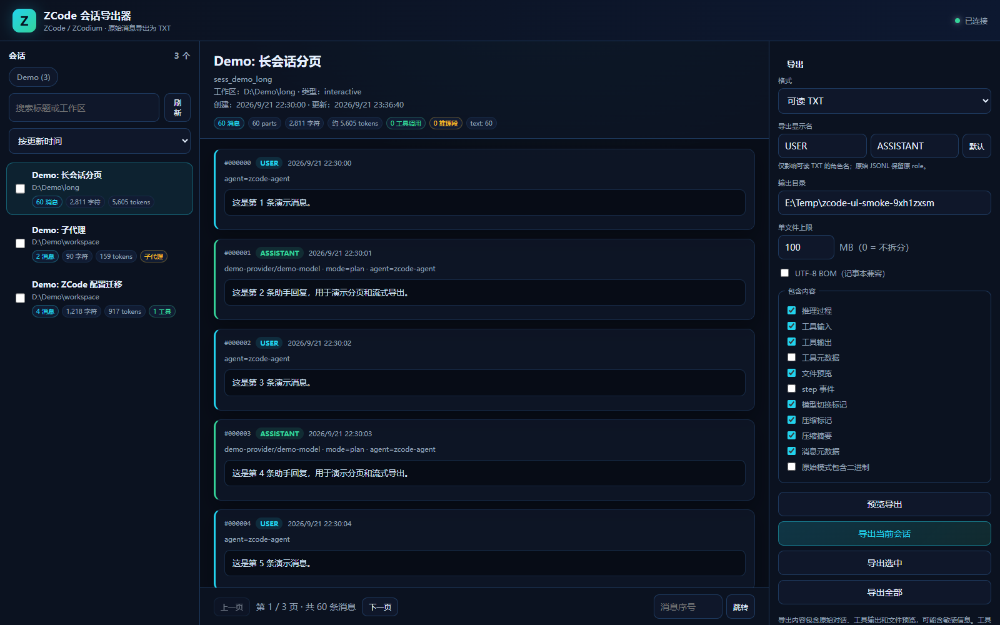

# zcode-session-exporter

[](https://github.com/Dongmingyue-loss/zcode-session-exporter/actions/workflows/ci.yml)
[](https://github.com/Dongmingyue-loss/zcode-session-exporter/releases)


把 **ZCode / ZCodium** 的会话消息导出为可读 TXT 或原始 JSONL。本地 Web GUI、分页预览、流式导出，适合百万级 token 会话。

**本地只读 · 不上传 · 无遥测 · 无需第三方 Python 包。**



## 为什么

ZCode / ZCodium 的会话保存在本地 SQLite 里，直接打开 `message` / `part` 表既不方便，也不适合把完整上下文交给别人或做二次分析。

这个工具提供一个本地网页：

- 浏览会话列表，查看消息数、字符数、估算 token、工具调用数
- 分页预览消息，不必把整个大会话塞进浏览器
- 预览最终 TXT / JSONL 排版，确认后再导出
- 流式导出，支持拆分文件、进度、取消和下载
- 源数据库只读，不会修改 ZCode / ZCodium

## 功能

- 自动发现 ZCode / ZCodium 的本地数据库
- 会话搜索、按更新时间/创建时间/消息数/字符数排序
- 消息分页预览，推理、工具调用、文件引用、模型切换、压缩标记可折叠
- 超长文本/工具输出截断显示，可单条加载完整内容
- **导出预览**：按当前导出选项分页预览整个会话
- **自定义角色显示名**：可把 `USER` / `ASSISTANT` 改成“我 / 助手”
- 可读 TXT：保留 user / assistant、推理、工具输入输出、文件预览、timeline、compaction
- 原始 JSONL：保留 message 与 part 的完整 JSON，可选是否包含二进制
- 单文件上限，超过后自动拆分为 `part001`、`part002`…
- UTF-8 BOM 选项
- 导出任务进度、取消、下载、打开目录
- 内置合成 Demo 数据，不需要真实会话即可试用

## 适用版本与系统

| 项目 | 支持情况 |
|---|---|
| 操作系统 | **Windows 10/11**：GUI 人工实测；**macOS 13+ / Linux**：GitHub Actions 真实 runner 跑后端、API、Playwright GUI 测试，并上传截图 |
| Python | **3.9+**；CI 覆盖 3.9 / 3.12；推荐 3.10–3.12 |
| ZCode / ZCodium | 当前 `session` / `message` / `part` 表结构；未来 schema 变化时会明确报缺失表 |
| SQLite | 使用 Python 自带 SQLite；JSON1 可用时走 SQL，不可用时自动回退到 Python 解析 |
| 浏览器 | Chrome / Edge / Firefox / Safari 现代版本 |
| 第三方依赖 | 运行时无依赖；开发和 CI 仅使用 Playwright、ruff |

> macOS/Linux 的 GUI 视觉验证来自 CI 截图，不包含人工点击。Windows 为人工视觉验收。

## 快速开始

要求：Python 3.9+，无需安装第三方包。

### Windows

```bat
start.cmd
```

### macOS / Linux

```bash
chmod +x start.sh
./start.sh
```

启动后会打印带 token 的本地 URL，并自动打开浏览器：

```text
http://127.0.0.1:3220/?token=...
```

### 使用 Demo 数据

没有 ZCode / ZCodium 数据，或不想让工具读取真实会话时：

```bash
python app.py --demo
```

Demo 数据库是合成的，包含 text / reasoning / tool / file / timeline / compaction 等消息类型。

### 指定数据库

```bash
python app.py \
  --zcode-db "/path/to/.zcode/cli/db/db.sqlite" \
  --zcodium-db "/path/to/.zcodium/cli/db/db.sqlite"
```

## 数据来源

默认查找：

| 来源 | 路径 |
|---|---|
| ZCode | `~/.zcode/cli/db/db.sqlite` |
| ZCodium | `~/.zcodium/cli/db/db.sqlite` |
| Demo | `demo/demo.sqlite` |

macOS / Linux 还会尝试：

- `~/Library/Application Support/ZCode/cli/db/db.sqlite`
- `~/Library/Application Support/ZCodium/cli/db/db.sqlite`
- `~/.config/ZCode/cli/db/db.sqlite`
- `~/.config/ZCodium/cli/db/db.sqlite`
- `~/.local/share/ZCode/cli/db/db.sqlite`
- `~/.local/share/ZCodium/cli/db/db.sqlite`

也可以使用环境变量 `ZCODE_DB` / `ZCODIUM_DB`。

## 导出格式

### 可读 TXT

```text
================================================================================
SESSION: 部署 ZCodium
ID: sess_...
Source: ZCode
Workspace: F:\Grok-4.5
Messages: 701
================================================================================

[000000] ASSISTANT  2026-10-18 20:49:15
--------------------------------------------------------------------------------
[meta] model=provider/model | mode=plan | agent=zcode-agent | tokens=...
[timeline] model_change: old -> new

[000001] USER  2026-10-18 20:49:15
--------------------------------------------------------------------------------
帮我部署下ZCodium

[000002] ASSISTANT  ...
--------------------------------------------------------------------------------
[reasoning]
...
[/reasoning]
...
[tool] Bash (call_...) status=completed
input:
{...}
output:
...
```

自定义显示名后：

```text
[000000] 助手  ...
[000001] 我  ...
```

### 原始 JSONL

第一行是 session 元数据，之后每条消息一行：

```json
{"type":"session","session":{...}}
{"type":"message","sequence":0,"message":{...},"parts":[{"id":"...","sequence":0,"time_created":...,"data":{...}}]}
```

原始模式不修改 `role` 字段；勾选“原始模式包含二进制”时保留内联 base64。

## 分页预览

右侧点击 **预览导出**：

- 使用与真实导出相同的格式化逻辑
- 每页 30 条消息
- 支持上一页 / 下一页 / 页码跳转
- 显示第 X / Y 页、本页条数、总条数、预览大小
- 第 1 页包含会话头，后续页直接显示消息
- “确认导出”导出完整会话，不是只导出当前预览页

## 大数据设计

- 会话统计使用一次分组扫描
- 消息预览使用 `LIMIT/OFFSET`，只取当前页
- 单页预览最多 200,000 字符
- 预览中的工具输出最多保留 4,000 字符
- 导出使用 SQLite 游标 + 文件流，逐条消息写入
- 拆分文件按 UTF-8 字节数计算，在消息边界轮转
- 已用 30,240,675 字符、3,029 条消息的会话验证

## 安全与隐私

- 只监听 `127.0.0.1`
- 每个 `/api/*` 请求需要启动时生成的随机 token
- 源数据库以 `mode=ro` 和 `PRAGMA query_only = 1` 打开
- 静态文件和下载路径做根目录校验
- 不把消息内容写入日志
- 不上传、不调用远程 API、无遥测
- 导出文件包含原始对话、工具输出和文件路径，请自行保管

更多内容见 [SECURITY.md](SECURITY.md)。

## 架构与数据库

- [架构说明](docs/ARCHITECTURE.md)
- [数据库 schema](docs/DATABASE.md)

## 测试与 CI

```bash
python -m unittest discover -s test -v
ruff check --select E9,F .
python scripts/make_demo_db.py
python test/ui_smoke.py
```

CI 矩阵：

| 任务 | 平台 | Python |
|---|---|---|
| unit / API | Ubuntu / Windows / macOS | 3.9、3.12 |
| GUI Playwright | Ubuntu / Windows / macOS | 3.12 |

GUI 截图作为 GitHub Actions artifact 上传。

## 已知限制

- 只读取 `message` / `part` 表，不导出 `session_entry` 运行事件
- 不导出 `rollout/*.jsonl` 模型 I/O 原始请求
- 工具元数据默认不写入可读 TXT，避免 base64 图片膨胀
- 可读 TXT 的推理内容会完整导出；不需要时可取消“推理过程”
- 大量会话导出时，ZIP 打包会额外占用磁盘和时间
- WAL 数据库在只读打开失败时会回退 `immutable=1`，可能看不到仅存在于 WAL 的最新数据

## 贡献

见 [CONTRIBUTING.md](CONTRIBUTING.md)。请勿提交真实会话数据库、导出文件或含真实数据的截图。

## License

MIT。见 [LICENSE](LICENSE)。
